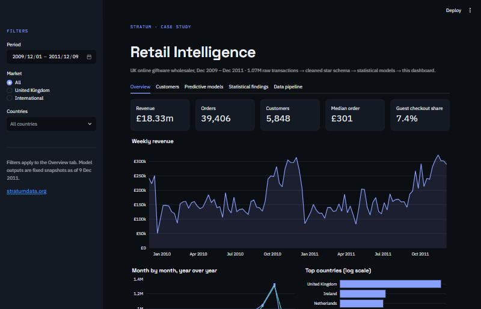
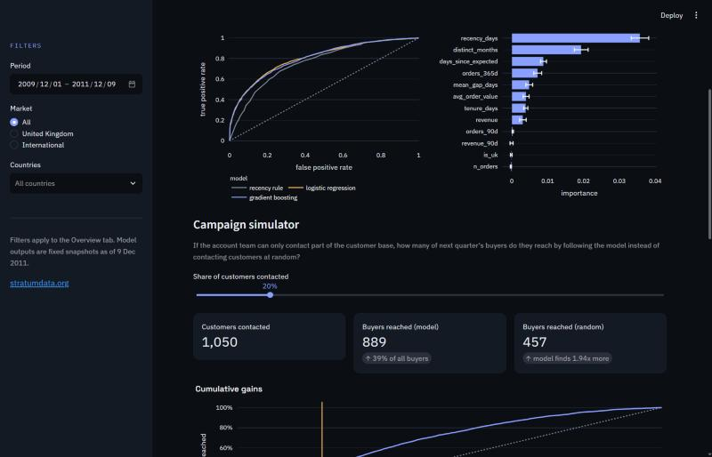

# Retail Intelligence

**An end-to-end data project: from a million messy transactions to decisions a business owner can act on.**

*A [Stratum](https://stratumdata.org) case study · data engineering · statistics · machine learning · analytics*



---

## The brief

A UK online giftware wholesaler has two years of raw sales exports: 1,067,371 invoice lines in a
spreadsheet. Many of its customers are small shops. The owner wants to know:

1. **Is the business growing?**
2. **Who are our valuable customers, and which ones are slipping away?**
3. **Who should the account team call this quarter?**
4. **What revenue should we plan for next quarter?**

The data is the public [UCI Online Retail II dataset](https://archive.ics.uci.edu/dataset/502/online+retail+ii)
(Dec 2009 – Dec 2011). It's real transaction data, with all the mess that comes with it.

## What the analysis found

| Question | Answer | How we know |
|---|---|---|
| Is the business growing? | **No. Revenue is flat.** Average daily revenue in 2011 is +2.2% vs 2010, with a 95% CI that includes zero | Welch's t-test + bootstrap, Holm-corrected (p = 0.58) |
| Who matters? | **22% of customers ("Champions") generate 69% of revenue.** The top 10% of customers by predicted value hold 55% of next year's expected revenue | RFM segmentation; BG/NBD + Gamma-Gamma lifetime value |
| Who to call? | A 90-day purchase model reaches **2.1x as many buyers as random** in its top decile, vs 1.8x for the usual "most recent first" rule | Out-of-time test, ROC-AUC 0.80 vs 0.76 |
| Next quarter? | Plan with a forecast that beats the seasonal-naive benchmark (MASE 0.96, ~10% weekly error, 3% quarter-total error) | 12-week backtest over the 2011 peak season |
| Myths busted | Gift-season customers are **more** likely to return (66% vs 59%), not less. Customers who return items spend **4x more**, not less | Two-proportion z-test; Mann-Whitney U with bootstrap CIs |

## What's in the project

```
Raw xlsx ──extract──▶ Bronze parquet ──transform──▶ Silver (tagged rows) ──load──▶ DuckDB star schema
 1.07M rows           untouched + lineage          every row gets a status          dims · facts · marts
                                                                                          │
                                         15 data quality checks ◀─────────────────────────┤
                                                                                          ▼
       Streamlit dashboard ◀── serving layer (1 MB parquet) ◀── analysis: tests · RFM · CLV · propensity · forecast
```

### 1. Initial dataset analysis → [`notebooks/01_exploratory_analysis.ipynb`](notebooks/01_exploratory_analysis.ipynb)
Data profiling before writing any cleaning rules. Each issue found became a documented rule in the ETL:

* 23% of lines have no customer ID (guest checkouts). They stay in revenue figures and are left out of customer models
* 34,335 exact duplicate lines, 19,494 cancellation lines, postage, Amazon fees and bad-debt write-offs mixed in with products
* one 80,995-unit order (£168k) that was cancelled minutes later
* up to 9 spellings of the same product name, and a B2B buying pattern (weekday office hours, almost no Saturdays)

### 2. ETL and data engineering → [`src/retail/`](src/retail), [`sql/`](sql)
* **Medallion layering:** the bronze layer is an untouched copy with lineage columns (source sheet, row
  number, ingest time); silver is typed and standardised; gold is a star schema built in DuckDB.
* **Nothing is silently dropped.** Every source row gets a `row_status` (valid sale, duplicate,
  cancellation, non-product, …), and the build reconciles row counts and revenue end to end.
* **SQL models in dbt style** (`sql/staging`, `sql/marts`): `dim_date`, `dim_product`, `dim_customer`,
  `fct_sales`, `fct_returns`, `fct_orders`, plus daily KPI, cohort and country marts.
* **15 data quality checks** (uniqueness, referential integrity, reconciliation, range checks). If an
  error-level check fails, the pipeline stops.
* Outlier detection uses a **robust z-score** (median/MAD of log line revenue per product) with an
  absolute cap. Outliers are flagged, not deleted.
* The full rebuild from the public source runs with one command in under a minute.

### 3. Statistical analysis and modelling → [`notebooks/02_statistical_modelling.ipynb`](notebooks/02_statistical_modelling.ipynb)
| Technique | Detail |
|---|---|
| **Hypothesis testing** | 5 business questions; non-parametric tests where the data is skewed; effect sizes with bootstrap CIs; Holm correction for multiple testing |
| **Segmentation** | RFM quintile scoring → named segments; k-means on log-scaled RFM with k chosen by silhouette |
| **Customer lifetime value** | BG/NBD and Gamma-Gamma **implemented from the papers' likelihoods** with `scipy`; validated on a 26-week holdout (total purchases within 1.7%; per-customer error 38% below baseline); parameter recovery tested on simulated data |
| **Propensity model** | Point-in-time features (no leakage, unit-tested), training stacked over 4 quarterly cutoffs, **out-of-time** test; logistic regression vs gradient boosting vs a business rule; ROC/PR, lift, calibration, permutation importance |
| **Forecasting** | Fourier-term seasonality (only 2 years of data, so no 52-week Holt-Winters), regression, SARIMAX and a forecast combination, all benchmarked against naive and seasonal-naive with MASE; empirical prediction intervals |
| **Market basket** | Pairwise support / confidence / lift computed in SQL |

Things I report even though they're less flattering: logistic regression matched gradient boosting (so ship
the simpler one); SARIMAX overfit and came last among the seasonal models; the ensemble was selected on
the same holdout it was scored on. Each is stated in the notebook.

### 4. Dashboard → [`dashboard/app.py`](dashboard/app.py)



A Streamlit app with five tabs:

* **Overview:** KPIs with like-for-like YoY deltas, filterable by period, market and country
* **Customers:** RFM treemap, cohort retention heatmap, lifetime value by segment, top accounts to protect
* **Predictive models:** model comparison, ROC and feature importance, an interactive **campaign
  simulator** ("if we can call 20% of customers, how many buyers do we reach?"), and the forecast with a
  backtest model picker
* **Statistical findings:** every hypothesis test written out in plain English, plus product affinities
* **Data pipeline:** lineage diagram, the row-status funnel, and live data quality check results

The app reads only a 1 MB **serving layer** of parquet files (committed), so it can be deployed without
the warehouse.

## Run it

Requires Python 3.11+ and [uv](https://docs.astral.sh/uv/).

```bash
uv sync
uv run retail all                       # download → ETL → quality checks → analysis → export (~1 min)
uv run streamlit run dashboard/app.py   # http://localhost:8501
uv run pytest                           # 18 tests: ETL rules, model correctness, dashboard smoke test
uv run python scripts/build_notebooks.py  # re-execute the notebooks
```

Only the dashboard (e.g. on Streamlit Community Cloud): point the app at `dashboard/app.py`. It uses
`dashboard/requirements.txt` and the committed `dashboard/data/`.

## Repository layout

```
src/retail/
  extract.py        download + checksum + bronze parquet
  transform.py      standardisation, row-status rules, canonical names, outlier flags
  load.py           silver → DuckDB, runs the SQL models
  quality.py        data quality checks → reports/data_quality.json
  export.py         serving layer for the dashboard
  analysis/         stats_tests · segmentation · clv · churn (propensity) · forecast
sql/                staging + mart models (DuckDB SQL)
notebooks/          EDA and modelling write-ups (jupytext .py sources + executed .ipynb)
dashboard/          Streamlit app + serving data
reports/            metrics.json, data_quality.json, figures/
tests/              pytest suite
.github/workflows/  CI: lint, tests, and a full pipeline rebuild
```

## Stack

Python · pandas · DuckDB · SQL · SciPy · statsmodels · scikit-learn · Plotly · Streamlit · pytest · GitHub Actions

---

*Built by [Stratum](https://stratumdata.org), an independent data science and engineering practice.
Have data sitting unused? [stratumfreelance@gmail.com](mailto:stratumfreelance@gmail.com)*
